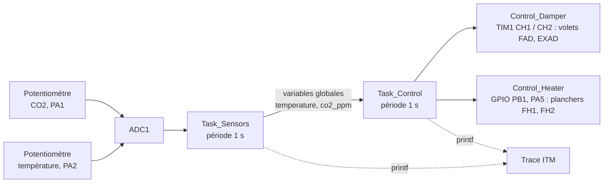

# Régulation HVAC sous FreeRTOS sur STM32

Contrôleur de chauffage et de ventilation à deux tâches FreeRTOS sur STM32 : une tâche lit la température et le CO₂ (potentiomètres sur l'ADC), l'autre commande les volets d'air en PWM et les planchers chauffants en GPIO.

## Vue d'ensemble

- **Cadre** : TP « OS temps réel », deuxième année du cycle ingénieur Instrumentation, Sup Galilée (Université Sorbonne Paris Nord).
- **Équipe** : binôme avec Sarah Dahmoun.
- **Périmètre** : le sujet prévoyait une communication Wi-Fi/MQTT ; elle a été abandonnée et le système simplifié avec des capteurs et actionneurs simulés.
- **État** : terminé, non maintenu.

## Objectifs

Découper une application de régulation en tâches FreeRTOS périodiques et piloter des périphériques STM32 (ADC, timer PWM, GPIO) avec la HAL.

## Architecture du système



## Matériel

| Élément | Détail |
|---|---|
| Carte | STM32 à cœur Cortex-M4 (`core_cm4.h`). Le paramètre `ADC_SAMPLETIME_3CYCLES` correspond à la HAL des STM32F4 : référence exacte **à confirmer** |
| Capteurs simulés | Potentiomètres : CO₂ sur PA1 (canal 1), température sur PA2 (canal 2) |
| Actionneurs simulés | Volets : PWM de TIM1, canal 1 (PA7) et canal 2 (PA4) ; planchers : LED sur PB1 et PA5 |

## Logiciel

C, STM32CubeIDE, HAL STM32, FreeRTOS (API native `xTaskCreate`, `vTaskDelay`), trace `printf` redirigée vers l'ITM.

## Implémentation

Le code est dans [`src/main.c`](src/main.c). **Il a été retranscrit à la main depuis les captures d'écran du compte rendu** : les fichiers d'origine n'ont pas été conservés.

| Fonction | Rôle |
|---|---|
| `_write()` | Redirige `printf` vers l'ITM (`ITM_SendChar`) |
| `Read_ADC_Channel()` | Reconfigure le canal de l'ADC, lance une conversion par scrutation et renvoie une valeur normalisée entre 0 et 1 |
| `Set_PWM()` | Convertit un rapport cyclique en pourcentage en valeur de comparaison du timer |
| `Read_CO2()` / `Read_Temperature()` | Mise à l'échelle : 0 à 2000 ppm et 0 à 40 °C |
| `Control_Damper()` | Ouverture des volets = commande CO₂ + commande température, plafonnée à 100 % |
| `Control_Heater()` | Planchers chauffants selon le seuil de 14 °C |
| `Task_Sensors()` / `Task_Control()` | Deux tâches de même priorité, période de 1 s, pile de 128 mots |

Commande des volets codée :

| CO₂ | Part CO₂ | Température | Part température |
|---|---|---|---|
| < 600 ppm | 0 % | < 21 °C | 0 % |
| ≤ 700 ppm | 25 % | < 23 °C | 50 % |
| ≤ 1000 ppm | 50 % | < 25 °C | 30 % |
| ≤ 1500 ppm | 75 % | < 30 °C | 10 % |
| > 1500 ppm | 100 % | ≥ 30 °C | 5 % |

## Principes d'ingénierie

- Ordonnancement préemptif FreeRTOS, tâches périodiques avec `vTaskDelay(pdMS_TO_TICKS(1000))`.
- Conversion analogique-numérique 12 bits (`/ 4095`).
- Modulation de largeur d'impulsion par le registre de comparaison du timer.
- Trace non intrusive par l'ITM du Cortex-M4.

## Résultats

Le compte rendu présente le fonctionnement par la trace ITM et les LED. Aucune mesure chiffrée n'est conservée : **à documenter** (capture de la console ITM ou photo du montage).

## Difficultés et limites

- **Code non compilable seul** : `main.h`, la configuration d'horloge, les initialisations CubeMX (GPIO, ADC1, TIM1) et le noyau FreeRTOS manquent.
- **Cahier des charges partiellement codé** : le sujet prévoyait des paliers de chauffage à 14, 17 et 19 °C et un réchauffeur d'air ; seul le seuil de 14 °C est codé. Au-dessus, FH1 s'éteint et FH2 **change d'état à chaque cycle** (`HAL_GPIO_TogglePin`), donc clignote à 0,5 Hz.
- **Variables partagées sans protection** : les mesures passent d'une tâche à l'autre par des variables globales, sans mutex ni file de messages.
- `fmin` (double) est appliqué à des entiers 8 bits ; une comparaison entière suffirait.
- Capteurs simulés : aucune mesure réelle de température ou de CO₂.

## Structure du dépôt

```
src/main.c   Programme principal (retranscrit depuis le compte rendu)
docs/        Compte rendu du TP (à relire avant publication)
assets/      Captures d'origine du code
```

## Exécution

Créer un projet STM32CubeIDE pour la carte utilisée, activer FreeRTOS (CMSIS ou API native), ADC1 (canaux 1 et 2), TIM1 en PWM (canaux 1 et 2), les GPIO PB1 et PA5 et la trace SWV/ITM, puis remplacer le `main.c` généré par celui-ci. Non vérifié lors de la rédaction de ce README.

## Médias

Captures d'origine du code, issues du compte rendu :


## Compétences démontrées

- FreeRTOS : création de tâches, priorités, temporisation non bloquante.
- HAL STM32 : ADC, timer PWM, GPIO.
- Débogage par trace ITM.
- Lecture critique du code par rapport au cahier des charges.

## Licence

Aucune licence n'a été définie.
